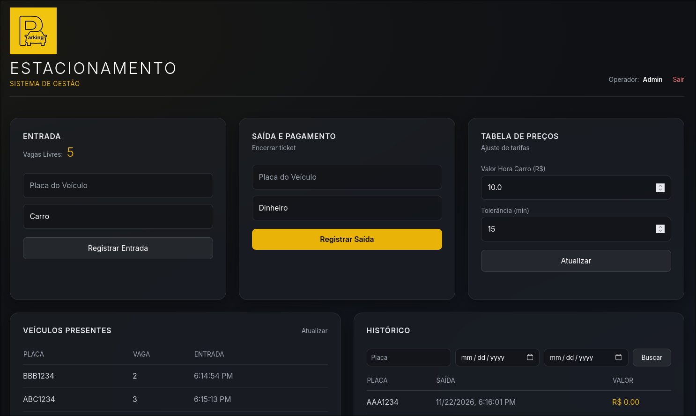
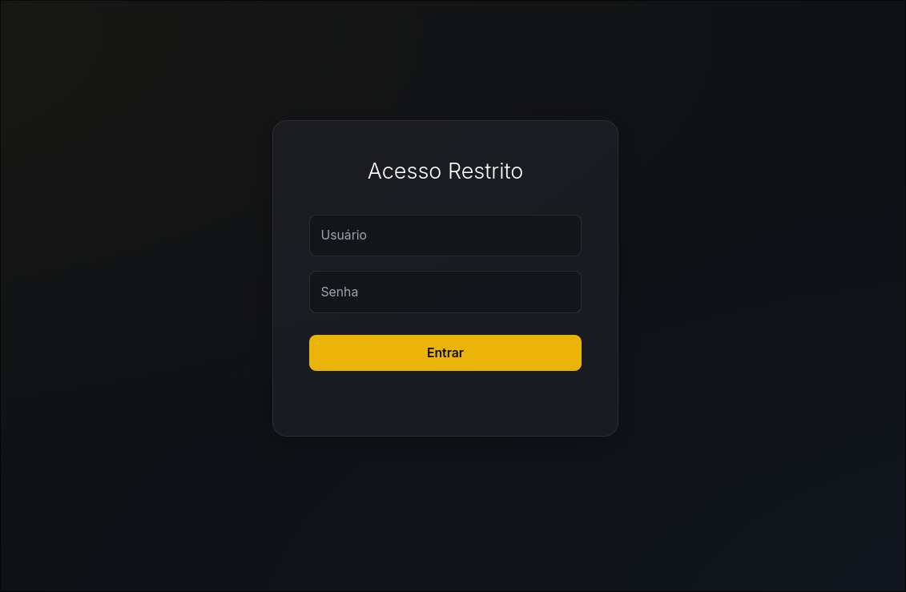

# 🚗 Sistema de Gestão de Estacionamento


> Acesse o projeto rodando ao vivo: **[https://estacionamento-alpha.vercel.app/](https://estacionamento-alpha.vercel.app/)**

## 📝 Sobre o Projeto

Este projeto nasceu como requisito avaliativo para a disciplina de **Projeto de Engenharia de Software II** da Universidade Regional Integrada do Alto Uruguai e das Missões (URI). O escopo original da disciplina consistia no planejamento e na modelagem do software: definição de requisitos, elaboração do diagrama de classes UML e a criação do plano de testes.

No entanto, como forma de ir além do solicitado e consolidar os conhecimentos na prática, **tomei a iniciativa de implementar o sistema real e colocá-lo no ar**. O objetivo passou a ser não apenas documentar, mas provar que a arquitetura pensada em sala de aula funciona em um ambiente de produção real. Para isso, o sistema foi construído com uma arquitetura Full-Stack (frontend integrado a um backend em Node.js/Express) e persistência de dados em um banco NoSQL na nuvem (MongoDB), garantindo que o cálculo de tarifas, o controle de vagas e os logs de auditoria sejam reais e persistentes. O deploy foi realizado na Vercel.



## 🚀 Como rodar este projeto localmente

Se quiser testar o código na sua máquina:

1. Clone o repositório:
   ```bash
   git clone https://github.com/emilyzugel/Estacionamento_Gerenciamento.git
